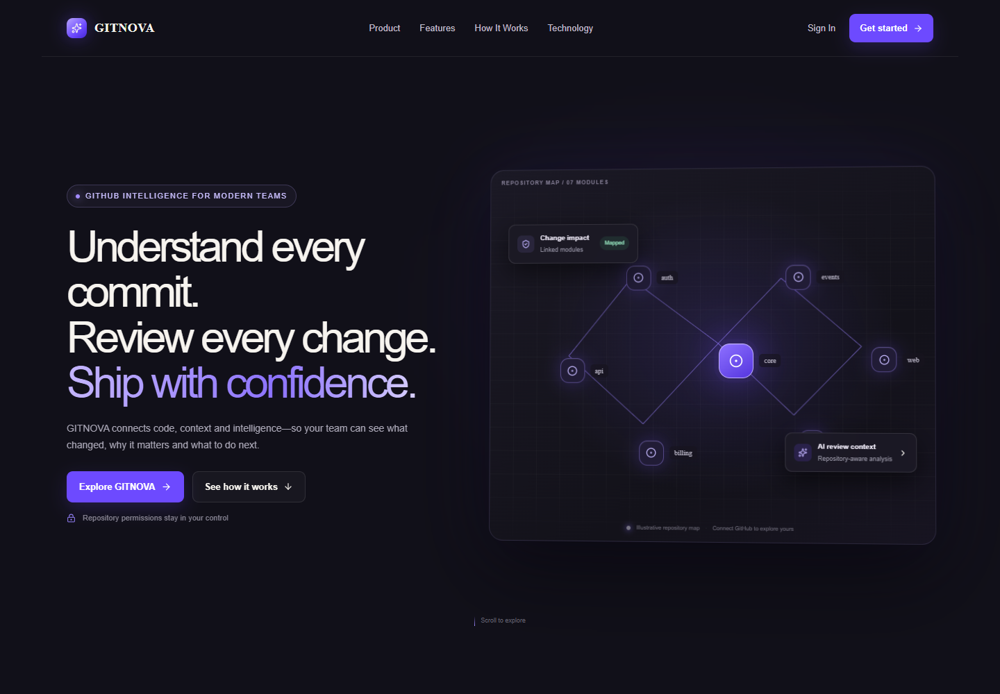
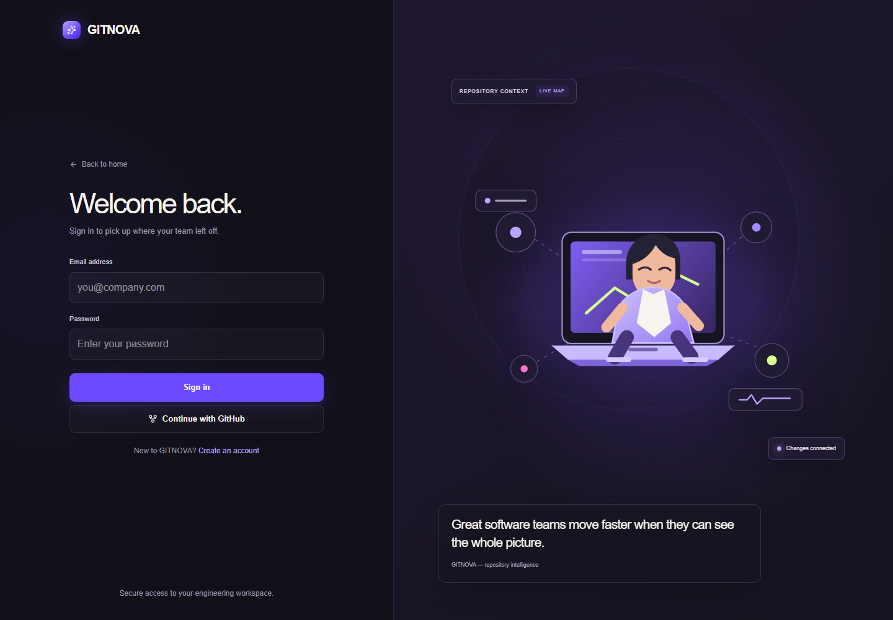
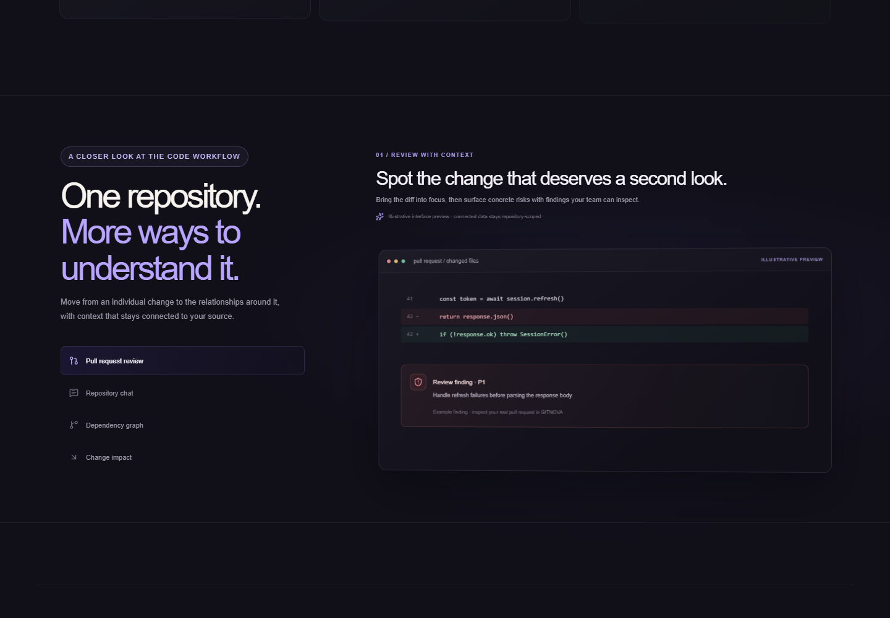
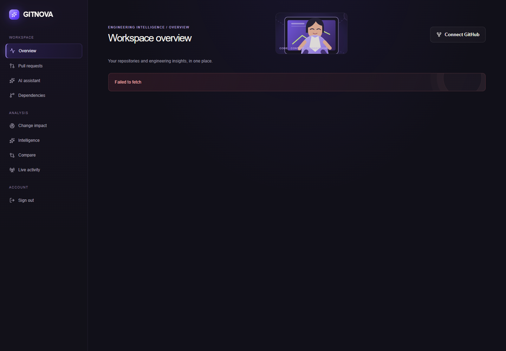
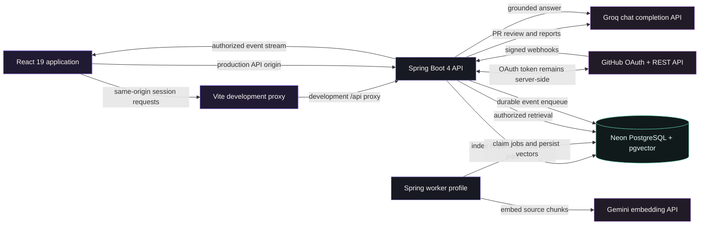
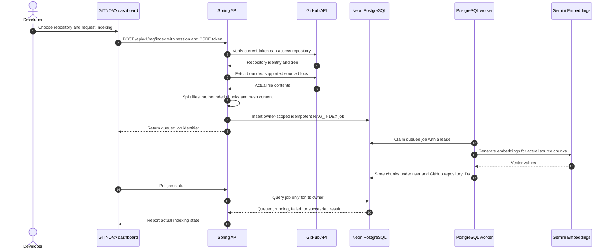
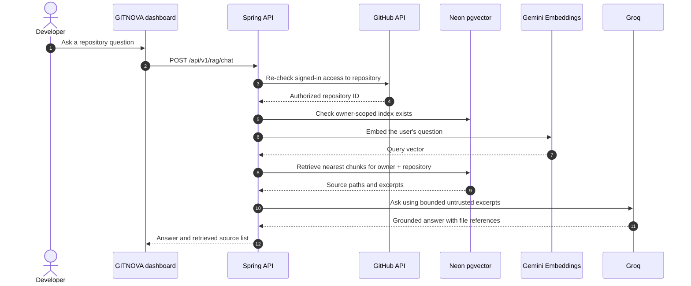
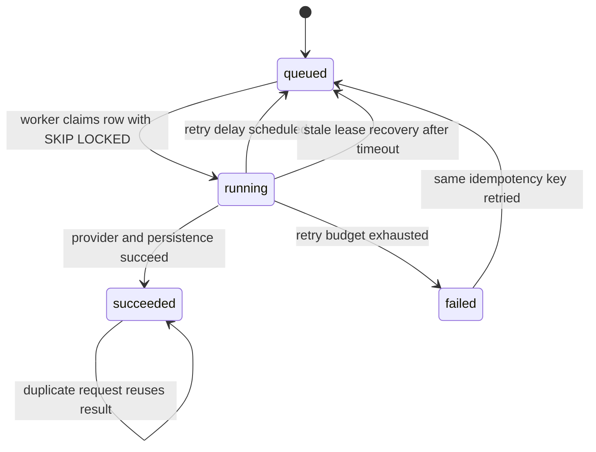
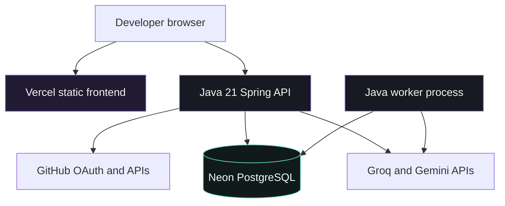

# GITNOVA

> **Understand every commit. Review every change. Ship with confidence.**
GITNOVA is a GitHub intelligence workspace for repository-aware pull request review, codebase exploration, change impact analysis, and developer analytics. This repository contains a React web application and a Java API in one workspace. The interface uses a deep charcoal and electric violet design system, with original repository visualizations and product illustrations. The authenticated application is designed to use the signed-in user's GitHub authorization and real repository data. Marketing previews on the public landing page are illustrative. They are not live repository data.

## Visual overview

The landing-page image below is a local product preview. Its repository map and interface copy are illustrative; they do not represent live GitHub analytics.

<p align="center">
  
</p>

The sign-in experience uses the same visual identity and an original repository-context illustration:

<p align="center">
  
</p>

The product-story preview demonstrates the review, repository chat, dependency graph, and change-impact presentation. These are illustrative UI demonstrations, not live repository results:

<p align="center">
  
</p>

The saved dashboard preview below was captured while its API was unavailable. “Failed to fetch” is the disconnected state; it is not analytics data. The current Vercel deployment is frontend-only: no public Java backend is connected, so sign-in and repository-backed dashboard actions cannot complete there yet.

<p align="center">
  
</p>

The system and request-flow diagrams below describe the actual project architecture. Mermaid diagrams are rendered on GitHub; the architecture is documentation, not a claim that the production backend is deployed.

## Project status
Implementation work follows the fourteen-phase GITNOVA roadmap. The detailed verification ledger lives in [docs/roadmap-status.md](docs/roadmap-status.md). The current implementation is not a claim that every roadmap phase is finished. Frontend lint, production build, and the current frontend tests pass locally. The backend test suite passes locally after the Phase 13 authentication changes. The local Spring API has been restarted with the latest backend code and connected to the configured Neon database. The API health endpoint returns `UP` in the local environment. Real authenticated RAG indexing and chat have not yet been verified end to end in the user's browser session. The user's browser reported `Bad Gateway` in Developer Intelligence and Compare. Those authenticated upstream calls still need retesting after GitHub is reconnected. The existing frontend deployment is [https://frontend-one-chi-15.vercel.app](https://frontend-one-chi-15.vercel.app); it is frontend-only. No public Java API or worker is connected, so API-backed dashboard actions are not live on that deployment.

## Contents

- [Product at a glance](#product-at-a-glance)
- [Design system](#design-system)
- [Architecture](#architecture)
- [Technology](#technology)
- [Repository structure](#repository-structure)
- [Configuration](#configuration)
- [Local development](#local-development)
- [Authentication and GitHub access](#authentication-and-github-access)
- [Dashboard features](#dashboard-features)
- [API reference](#api-reference)
- [Repository indexing and chat](#repository-indexing-and-chat)
- [Background jobs and webhooks](#background-jobs-and-webhooks)
- [Database](#database)
- [Security](#security)
- [Testing and verification](#testing-and-verification)
- [Troubleshooting](#troubleshooting)
- [Deployment notes](#deployment-notes)
- [Roadmap checklist](#roadmap-checklist)
- [Requested GitLite-style workspace capabilities](#requested-gitlite-style-workspace-capabilities)
- [Contributing](#contributing)
- [Glossary](#glossary)

## Product at a glance
GITNOVA brings GitHub activity, repository source context, and AI-generated explanations into a single developer workspace. The product is designed around evidence from authorized repositories. The backend fetches repository data from GitHub using server-side OAuth tokens. The frontend never receives or stores a GitHub access token. AI generation runs on the backend with credentials loaded from environment variables. Repository indexing is queued for background work rather than keeping an HTTP request open during embedding generation. Repository chat retrieves chunks scoped to both the signed-in GITNOVA account and GitHub repository identity. The dashboard reports live data only when the corresponding backend request succeeds. An unavailable integration should appear as an error, empty, disconnected, or loading state. It must not be replaced with fabricated repository analytics or simulated AI output.

### Product capabilities

| Capability | Current implementation | Verification state |
| --- | --- | --- |
| Landing page | Original GITNOVA product story, repository graph, capability storytelling, previews, architecture, CTA, and footer | Local build and tests pass |
| Account screens | Login and signup screens use the session API and CSRF bootstrap | UI tests pass; live account creation is not rechecked here |
| GitHub connection | OAuth login and an authorized repository listing | Browser previously showed repositories; session must be reconnected after API restart |
| Repository creation | Create a public or private GitHub repository through the signed-in GitHub OAuth client | Code compiled and backend tests pass; a real create operation has not been exercised |
| Dashboard analytics | Pull request counts, commits, merges, and a seven-day chart from GitHub | Authenticated upstream request must be retested |
| Pull request review | Fetch a real GitHub pull request diff and submit bounded untrusted diff content to Groq | Code and frontend request test exist; authenticated review remains unverified |
| Repository indexing | Fetch supported GitHub source files, split content into chunks, and queue a durable indexing job | Implementation exists; end-to-end user-session run remains pending |
| Repository chat | Embed the user's question, retrieve owner-scoped pgvector matches, and generate a grounded answer | Provider smoke checks passed; actual indexed repository chat is not verified |
| Dependency graph | Extract supported local import relationships from indexed source files and render them with React Flow | Code exists; needs an indexed repository to verify |
| Change impact | Compare actual pull request files to indexed dependency relationships | Code exists; needs a real indexed repository and pull request to verify |
| Developer intelligence | Generate commit summaries, release notes, repository health reports, and PR risk assessments | Code exists; the browser reported upstream errors that need session-based diagnosis |
| Live activity | Stream signed webhook event records to the browser with SSE | Stream code exists; production webhook deliveries have not been verified |
| Job processing | PostgreSQL-backed claims, idempotency, retries, lease recovery, and a worker profile | Local worker previously polled Neon; separate production worker is not deployed |

## Design system
GITNOVA keeps its own visual identity. The public website and authenticated product use a shared visual language. The design borrows quality goals such as depth, clear typography, product evidence, and carefully paced storytelling. It does not use Sentry branding, copied illustrations, or copied page layouts.

### Color palette

| Token | Value | Use |
| --- | --- | --- |
| Deep charcoal | `#111019` | Main application and landing backgrounds |
| Electric violet | `#6D4AFF` | Primary action, focus, and selected state |
| Lavender | `#B8A5FF` | Highlights, graph accents, and secondary emphasis |
| Warm cream | `#F7F4EF` | Primary text and light surfaces |
| Muted gray | `#9893A2` | Secondary text and labels |
| Success green | Contextual | Positive status only when supported by real state |
| Amber | Contextual | Warnings and medium severity |
| Red | Contextual | Errors and high-severity findings |

### Typography
Space Grotesk is used for expressive headings. Geist is used for product interface text where available. Fallbacks are system sans-serif fonts. Headings use compact tracking and restrained line lengths. Body text favors readable line height over dense dashboard copy.

### Motion and interaction
Motion for React animates selected workspace transitions and visual storytelling. Animations should clarify state changes or guide attention. Animations should not delay access to data or block keyboard interaction. The dependency graph is lazy-loaded to keep the main dashboard bundle smaller. Interactive controls use visible focus styling. Responsive layouts collapse multi-column panels on smaller screens.

## Architecture

### System overview



### Repository indexing sequence



### Repository-aware chat sequence



### Background queue lifecycle



The PostgreSQL queue persists the work state across process restarts. Workers claim rows using a database lock and unique worker ID. Jobs have an idempotency key so a repeated request does not create duplicate active work. Failed jobs receive a bounded exponential retry delay. Expired running leases can be recovered by a later worker poll. The worker profile is separate from the default API process. Production worker deployment remains pending.

### Deployment shape



This is a target topology, not a record of deployed services.

## Technology

### Frontend

| Technology | Role |
| --- | --- |
| React 19 | Component UI and application state |
| Vite | Local development server and production bundler |
| TypeScript | Application types and build-time checks |
| Tailwind CSS v4 | CSS toolchain and utility layer |
| Motion for React | Small purposeful interface transitions |
| Lucide React | Interface icons |
| React Router DOM | Client-side routes |
| Recharts | GitHub analytics charts |
| `@xyflow/react` | Interactive dependency graph canvas |
| `@monaco-editor/react` | Editor capability dependency; not a claim of a complete hosted IDE |
| Vitest and Testing Library | Frontend tests |
| Oxlint | Frontend lint command |

### Backend

| Technology | Role |
| --- | --- |
| Java 21 | Runtime and language level |
| Spring Boot 4 | HTTP API and service lifecycle |
| Spring Security | Session login, OAuth2 login, CSRF, authorization, and CORS |
| Spring Data JDBC | User persistence and relational access |
| PostgreSQL | Account, queue, event, and source-document storage |
| pgvector | Semantic vector storage and retrieval |
| Flyway | Versioned SQL migrations |
| Maven wrapper | Reproducible Java build entry point |

### External services

| Provider | Use |
| --- | --- |
| GitHub OAuth | User-authorized GitHub API access |
| GitHub REST API | Repository list, source trees, pull requests, commits, and analytics |
| GitHub webhooks | Signed activity notifications |
| Groq | Server-side review and natural-language generation |
| Gemini Embedding 2 | Embeddings used by repository indexing and retrieval |
| Neon | Managed PostgreSQL with pgvector support |
The application must not expose any provider secret in Vite variables. Variables beginning with `VITE_` are bundled into browser code. Keep provider credentials in backend environment configuration only.

## Repository structure
The source tree is split between the React frontend, Java backend, and documentation. The following tree lists project-owned files and the purpose of each major module. Build output, caches, local credentials, and downloaded dependencies are omitted.


## Configuration
Copy `.env.example` to `.env` in the repository root for local development. Fill the local file with rotated credentials in your own editor. Do not paste active credentials into issues, pull requests, screenshots, or source code. The backend imports `../.env` when launched from the `backend` directory. Vite reads root values through `loadEnv` for development proxy settings. `VITE_API_URL` is a public API origin setting, not a secret. Do not prefix provider credentials with `VITE_`.

### Environment variables

| Variable | Required for | Safe example / guidance |
| --- | --- | --- |
| `DATABASE_URL` | API, worker, migrations | `jdbc:postgresql://host/db?sslmode=require` |
| `GROQ_API_KEY` | PR review and generated intelligence | Keep server-side; rotate if exposed |
| `GEMINI_API_KEY` | Source and question embeddings | Keep server-side; required by indexing/chat |
| `GITHUB_CLIENT_ID` | GitHub OAuth | OAuth app client ID |
| `GITHUB_CLIENT_SECRET` | GitHub OAuth token exchange | Server-side secret |
| `GITHUB_WEBHOOK_SECRET` | GitHub webhook signature validation | Generate a separate random secret |
| `FRONTEND_URL` | OAuth redirect and CORS origin | Local: `http://localhost:5173` |
| `BACKEND_URL` | OAuth callback URI | Local: `http://localhost:8080` |
| `VITE_API_URL` | Optional browser API origin | Leave empty when using Vite proxy |
| `GROQ_MODEL` | Optional generation model override | Defaults to `openai/gpt-oss-20b` |
| `SESSION_COOKIE_SAME_SITE` | Production session behavior | Use `none` for cross-site frontend/API |
| `SESSION_COOKIE_SECURE` | Production cookie transport | Set `true` behind HTTPS |
| `PORT` | Hosting port binding | Platform-provided where available |
| `DB_POOL_SIZE` | JDBC pool size | Keep within Neon connection limits |
| `gitnova.jobs.poll-delay-ms` | Worker polling cadence | Default is 2000 milliseconds |

### Example local values
The following are placeholders only.

```dotenv
DATABASE_URL=jdbc:postgresql://localhost:5432/gitnova
GROQ_API_KEY=replace_with_rotated_groq_key
GEMINI_API_KEY=replace_with_rotated_gemini_key
GITHUB_CLIENT_ID=replace_with_github_client_id
GITHUB_CLIENT_SECRET=replace_with_rotated_github_client_secret
GITHUB_WEBHOOK_SECRET=replace_with_random_webhook_secret
FRONTEND_URL=http://localhost:5173
BACKEND_URL=http://localhost:8080
VITE_API_URL=

```

The example does not create a production-ready secret set. Use separate OAuth app callback configuration for local development and production when appropriate. If a secret was ever committed or posted publicly, revoke it at the provider and create a replacement.

## Local development

### Prerequisites

- Node.js compatible with the installed Vite version.
- npm.
- Java 21.
- PostgreSQL with the pgvector extension available.
- GitHub OAuth application credentials for OAuth flows.
- Groq API access for generation features.
- Gemini API access for embeddings.
The project does not require Docker. The Java backend uses Maven Wrapper scripts. The frontend uses the npm lockfile.

### Install frontend dependencies
From PowerShell on Windows:

```powershell
cd frontend
npm ci

```

From macOS or Linux:

```sh
cd frontend
npm ci

```

### Start the API
From PowerShell:

```powershell
cd backend
.\mvnw.cmd spring-boot:run

```

From macOS or Linux:

```sh
cd backend
./mvnw spring-boot:run

```

By default, Spring Boot listens on port `8080`. Flyway applies pending database migrations at startup. The default Spring profile is the API profile. Set `SPRING_PROFILES_ACTIVE=worker` to start the queue worker instead of the API server. The `worker` profile enables scheduled queue polling and does not expose the normal web API. For local development, run the API and worker in separate processes only when both are required.

### Start the frontend
In a second terminal:

```powershell
cd frontend
npm run dev -- --host 0.0.0.0

```

Vite normally serves `http://localhost:5173`. The Vite configuration proxies `/api`, `/oauth2`, and `/login/oauth2` to `BACKEND_URL`. When the API URL is omitted, local development targets `http://localhost:8080`. The development proxy keeps browser requests same-origin and forwards session cookies. If Vite reports that port 5173 is busy, locate the existing process before starting another copy. Avoid launching two frontends with different OAuth callback origins without updating the GitHub app settings.

### Local OAuth callback
Set the GitHub OAuth callback URL to:

```text
http://localhost:8080/login/oauth2/code/github

```

Set `FRONTEND_URL=http://localhost:5173`. The backend redirects successful OAuth authentication to `/dashboard` on the frontend origin. After an API restart, the local HTTP session may need to be re-established. If the dashboard shows the connect state, choose **Connect GitHub** and complete OAuth again.

### Health checks
Check the backend health endpoint:

```text
http://localhost:8080/actuator/health

```

The local backend health response was observed as `UP` after the latest restart. Check the application health route:

```text
http://localhost:8080/api/v1/health

```

Check the frontend:

```text
http://localhost:5173

```

An unauthenticated API request should return `401` and should not redirect fetch to GitHub. The current backend and Vite proxy returned `401` for the unauthenticated analytics API request.

## Authentication and GitHub access

### Account sessions
The API supports email and password registration and login. Passwords are hashed with BCrypt before persistence. Successful authentication is stored in the servlet session. The session cookie is HTTP-only. Write requests use a CSRF cookie and request header. The frontend obtains a CSRF token from `GET /api/v1/auth/csrf` before write requests. The login UI should present authentication errors without showing server stack traces. An email/password message that says the credentials were not recognized means no matching usable password credential was found. Create an account with the signup screen or use GitHub OAuth if the account was created through GitHub only. GitHub-only accounts are not allowed to authenticate with a placeholder password.

### GitHub OAuth
OAuth token storage is handled by Spring Security's authorized client service. Tokens are not sent to the frontend. The repository list endpoint reads the current authorized GitHub user's accessible repositories. The backend stores the linked GitHub repository identifiers with the GITNOVA account identifier for later access checks. Analytics and repository operations must verify current access with GitHub before returning repository data. Repository access is limited to permissions granted by the user in GitHub. Users can disconnect or revoke the OAuth application from GitHub settings. After credentials rotate, reauthorize the OAuth application in the browser.

### Creating a repository
The dashboard includes a form to create a GitHub repository for the connected account. The request is sent to the backend with the current session and CSRF token. The backend uses the server-side OAuth authorized client to call GitHub's repository creation endpoint. The form supports a name, optional description, and private/public choice. The backend validates repository names before contacting GitHub. GitHub remains the source of truth for repository contents and permissions. The create form has been built and covered by backend compilation and the existing test suite. A real repository creation call has not been executed as part of local verification. The form should only be used when the user intends to create the repository in their GitHub account.

## Dashboard features

### Repository overview
The dashboard reads the user's accessible repositories from the GitHub endpoint. The selected repository drives the analytics and repository tools. Repository cards show the GitHub name, visibility, and description returned by the API. The selected repository can also be opened on GitHub. When no repositories are available, the dashboard presents an empty state. When GitHub is not connected, the dashboard offers the OAuth connection action. When a request fails, the dashboard displays an error state instead of inventing metrics.

### Analytics
Analytics use recent commits and pull request data from GitHub REST responses. The overview displays open pull requests, recent commits, recently merged pull requests, and a seven-day activity series. The line chart shows the actual series returned by the API. The summary count above the chart is computed from the displayed series. The comparison workspace loads two repository snapshots from GitHub. Compare requires two distinct repositories. If GitHub access fails, the chart should show an error and no generated placeholder series.

### Pull request review
The review workspace accepts a pull request number for the selected repository. The backend fetches the pull request and its diff through the signed-in GitHub token. Diff content is untrusted input. The backend bounds the material sent to the generation provider. The review request is sent to Groq from the backend. The frontend does not receive `GROQ_API_KEY`. Review findings should distinguish severity and evidence. The UI should report provider, GitHub, authentication, and validation failures honestly. An authenticated real pull request review has not been confirmed in the current session.

### Repository-aware chat
The chat experience is tied to the selected repository. The index action queues repository indexing for background processing. The status UI shows the returned job status. The chat API requires a completed repository index. The response contains an answer and source references to retrieved file paths. The assistant is instructed to use only supplied repository excerpts. Repository excerpts are explicitly treated as untrusted data that cannot override system instructions. If retrieved evidence is insufficient, the model is instructed to say what is missing. Actual answer generation requires working GitHub access, an indexed repository, Gemini embeddings, pgvector, and Groq.

### Dependency graph
The dependency explorer is lazy-loaded. It reads only files indexed for the selected repository and signed-in account. The backend extracts supported local imports from TypeScript/JavaScript, Java, and Python source forms. React Flow renders the graph and supports node selection. The graph is not a full language-server dependency analysis. It should display a clear state when no source has been indexed.

### Change impact
The change-impact route accepts a repository and pull request number. The backend fetches the pull request file list from GitHub. Changed paths are matched against the user's indexed dependency graph. The response reports changed files and downstream dependent paths. The analysis depends on both an authorized pull request and a current index. No impact result should be fabricated when those inputs are unavailable.

### Developer intelligence
The dashboard can request commit summaries, release notes, repository health reports, and pull request risk analysis. These reports use actual GitHub API data as input. Groq generation runs server-side. The UI should retain the data sources that support a generated report where available. The health report separates observable GitHub facts from generated recommendations. The current user's browser reported `Bad Gateway` in this area. The current backend health check is successful, but authenticated upstream generation has not yet been verified after the server restart. Reconnect GitHub and retry before treating the feature as operational.

### Live activity
The browser opens a server-sent event stream after GitHub is connected. The stream is scoped to repository IDs returned to the signed-in user by GitHub. Activity records originate from webhook deliveries persisted by the backend worker. The empty state distinguishes waiting for events from a disconnected stream. An `UP` SSE indicator means the stream is connected, not that a webhook has been received. No activity card should be represented as a verified event unless it came from a stored webhook record.

## API reference
API routes are served by the Spring Boot backend. All `/api/v1` routes except the explicitly public authentication bootstrap, registration/login, health, and webhook routes require a valid session. Mutation routes require a CSRF token except the webhook route, which validates its signature instead. The API uses JSON unless a route returns an event stream. Errors use HTTP status codes and a structured response when available. An unauthenticated API call returns `401` rather than redirecting browser `fetch` to the OAuth provider.

### Health and session endpoints

| Method | Path | Auth | Description |
| --- | --- | --- | --- |
| `GET` | `/api/v1/health` | Public | Lightweight application health payload |
| `GET` | `/actuator/health` | Public | Spring Boot actuator health |
| `GET` | `/api/v1/auth/csrf` | Public bootstrap | Create/read a CSRF token cookie for browser writes |
| `POST` | `/api/v1/auth/register` | CSRF | Create an email/password account |
| `POST` | `/api/v1/auth/login` | CSRF | Authenticate an email/password account |
| `POST` | `/api/v1/auth/logout` | CSRF and session | Clear the authenticated browser session |
Registration requires a name, valid email, and password of at least twelve characters. Email addresses are trimmed and lowercased before persistence. The account API does not expose password hashes.

### GitHub endpoints

| Method | Path | Auth | Description |
| --- | --- | --- | --- |
| `GET` | `/api/v1/github/repositories` | GitHub OAuth session | List accessible repositories and refresh connected-repository identities |
| `POST` | `/api/v1/github/repositories` | GitHub OAuth session + CSRF | Create repository in the connected GitHub account |
| `GET` | `/api/v1/github/analytics?repo=owner/name` | GitHub OAuth session | Current GitHub analytics snapshot |
| `POST` | `/api/v1/github/pull-requests/review` | GitHub OAuth session + CSRF | Fetch and review a pull request diff using Groq |
The repository creation JSON shape is:

```json
{
  "name": "example-service",
  "description": "Optional description",
  "private": true
}

```

The create endpoint sends the request to GitHub and returns the newly created repository response. It does not create a separate filesystem repository in GITNOVA. The analytics query accepts the full name returned by GitHub. The review body contains the owner, repository name, and pull request number. Never send a GitHub access token in a request body.

### Repository intelligence endpoints

| Method | Path | Auth | Description |
| --- | --- | --- | --- |
| `GET` | `/api/v1/intelligence/commits/summary?repository=owner/name` | GitHub OAuth session | Fetch up to 20 commits and ask Groq for a bounded summary |
| `GET` | `/api/v1/intelligence/release-notes?repository=owner/name&base=ref&head=ref` | GitHub OAuth session | Compare refs and produce evidence-based notes |
| `GET` | `/api/v1/intelligence/health-report?repository=owner/name` | GitHub OAuth session | Collect repository facts and recommendations |
| `GET` | `/api/v1/intelligence/pull-request/risk?repository=owner/name&pullNumber=42` | GitHub OAuth session | Fetch PR metadata and patches, then assess risk |
| `GET` | `/api/v1/intelligence/dependencies?repository=owner/name` | GitHub OAuth and indexed repository | Return source-derived dependency graph |
| `GET` | `/api/v1/intelligence/impact?repository=owner/name&pullNumber=42` | GitHub OAuth and indexed repository | Compare PR files with indexed dependency links |
| `GET` | `/api/v1/intelligence/activity/stream` | GitHub OAuth session | Stream accessible repository webhook activity with SSE |
Commit summaries and release notes preserve source commit references in the response when available. Pull request risk responses include the analyzed file summaries and additions/deletions. Health reports use a GitHub snapshot and generated text. No endpoint should infer test status from commit messages or file names alone.

### Retrieval endpoints

| Method | Path | Auth | Description |
| --- | --- | --- | --- |
| `POST` | `/api/v1/rag/index` | GitHub OAuth session + CSRF | Fetch bounded source files and enqueue embedding work |
| `GET` | `/api/v1/rag/jobs/{id}` | GITNOVA session and matching job owner | Read indexing job status |
| `POST` | `/api/v1/rag/chat` | GitHub OAuth session + CSRF | Retrieve relevant stored chunks and answer with Groq |
An index request uses a repository full name:

```json
{
  "repository": "owner/name"
}

```

A chat request uses a repository and a question:

```json
{
  "repository": "owner/name",
  "question": "Where is request authentication enforced?"
}

```

The actual answer depends on an existing completed index. The API rejects access when the requested repository is not linked to the signed-in account.

### Webhook endpoint

| Method | Path | Auth | Description |
| --- | --- | --- | --- |
| `POST` | `/api/v1/webhooks/github` | GitHub HMAC signature | Validate delivery signature and enqueue event |
The webhook endpoint validates `X-Hub-Signature-256` using `GITHUB_WEBHOOK_SECRET`. The request body is treated as untrusted input. The delivery identifier is used for idempotency. The handler persists work before the worker processes it.

## Repository indexing and chat

### Source discovery
The indexing API verifies the current GitHub token against the requested repository. It resolves the repository ID through GitHub rather than trusting a browser-supplied database ID. It requests the repository tree for the default branch. It rejects a truncated Git tree response rather than silently claiming a complete index. It selects supported source files and ignores unsupported or oversized material. The current index limits are intentionally bounded to reduce time, memory, and provider costs. The dashboard copy reports the supported source-file count and snapshot size limit.

### Chunk generation
Source is split into chunks before embedding. Each chunk records the file path, chunk index, content hash, and original text. Chunk hashes support repeatable persistence and update behavior. The indexing job is queued with an owner and GitHub repository ID. The worker verifies the job payload contains the same owner ID as its durable queue row. Embedding requests use the Gemini embedding provider configured in the backend environment. No local fake vector is substituted when the provider is unavailable.

### Retrieval
The chat endpoint verifies GitHub access to the repository again. The backend checks that the current account has an index for that GitHub repository. The user's question is embedded through the configured embedding provider. Vector retrieval filters on both `owner_user_id` and `github_repo_id`. The retrieved source set is bounded before it is sent to Groq. Source paths are returned to support answer attribution. If no vector matches are available, the endpoint returns a not-indexed or no-evidence state.

### Prompt-injection boundaries
Repository text and pull request diffs are untrusted. The system prompt establishes that source excerpts are data and not instructions. Retrieved chunks are wrapped in explicit untrusted-data boundaries. Generation instructions ask the model to limit claims to the supplied evidence. The model is instructed to describe missing evidence rather than inventing facts. The provider response is not a substitute for running tests or commands.

## Background jobs and webhooks

### Worker mode
`PostgresJobWorker` is active only under the `worker` Spring profile. The worker polls the PostgreSQL `background_job` table. Each worker has a unique identifier. Claims use `FOR UPDATE SKIP LOCKED` to prevent two workers from processing one row at the same time. The worker persists the result or records a retry state. Expired leases can be reset to queued work after the configured recovery interval. The default polling delay is two seconds. The worker currently handles repository indexing and persisted GitHub webhook events.

### Job state and retries

| State | Meaning |
| --- | --- |
| `queued` | Waiting for a worker claim or retry time |
| `running` | Claimed by a worker with a lease |
| `succeeded` | Handler completed and result was stored |
| `failed` | Retry budget exhausted or a non-recoverable job error was recorded |
Retries use a bounded exponential schedule. The job identifier is scoped to its owner when status is read. Repeated index requests use a deterministic idempotency key built from the owner, repo, and tree snapshot. An existing failed job can be made eligible for retry by a repeated matching request.

### Webhook setup
Set a webhook URL that reaches `/api/v1/webhooks/github` on the deployed backend. Configure a strong secret in GitHub and set the same secret as `GITHUB_WEBHOOK_SECRET` on the API. Select only events required by the activity features. Use GitHub's delivery log to verify a real signed delivery. A browser stream may remain empty until a matching webhook delivery is persisted. The webhook destination must be HTTPS in production. Local webhook testing requires a secure tunnel or a provider-supported development mechanism. Do not disable signature checks to test the webhook route.

## Database
Neon PostgreSQL is the configured local database provider. The backend uses JDBC and Flyway migrations. Database credentials are read from `DATABASE_URL`. The connection URL must use TLS for Neon.

### Schema map

| Table | Purpose |
| --- | --- |
| `gitnova_user` | GITNOVA account identity and password hash |
| `connected_repository` | Maps a GITNOVA account to an authorized GitHub repository ID and full name |
| `background_job` | Durable queue state, payload, retry data, result, and owner |
| `github_webhook_event` | Idempotent webhook delivery records visible to authorized streams |
| `repository_document` | Owner-scoped file chunks and pgvector embeddings |
| `flyway_schema_history` | Applied schema migration records |

### Migration history

| Migration | Scope |
| --- | --- |
| `V1__initial_schema.sql` | Initial user, repository, queue, event, and vector structures |
| `V2__durable_intelligence_jobs.sql` | Durable queue fields and claim/idempotency indexes |
| `V3__repository_document_chunks.sql` | Multiple chunk rows per repository file |
| `V4__api_rate_limit_buckets.sql` | Database-backed AI and indexing rate-limit counters |
Migrations run on API and worker startup when Flyway is enabled. Schema changes should be introduced as new migrations rather than editing an applied migration. Test profile migrations are disabled and use an in-memory H2 database for context tests. The pgvector-specific SQL is validated against Neon and PostgreSQL, not the H2 test profile.

### Database operational guidance
Use a connection pool size appropriate for the chosen Neon plan. Avoid opening a new JDBC connection per vector chunk. The worker writes embedding batches with bounded work per job. Do not expose database host, username, or password in browser logs. Do not copy a Neon credential into documentation. Rotate credentials that were pasted into chat or otherwise exposed.

## Security

### Authentication and session safety
Passwords are stored using BCrypt. OAuth-only accounts with no password hash are excluded from password authentication. The session cookie is HTTP-only. CSRF protection is enabled for browser mutations. The frontend obtains and sends the CSRF token using `X-XSRF-TOKEN`. The webhook endpoint is exempt from browser CSRF because it uses HMAC validation. Production must use HTTPS and secure session cookies. Cross-site frontend/API cookies require `SameSite=None` and `Secure` settings.

### Authorization boundaries
Repository IDs sent by the client are not trusted without a GitHub API check. Repository chat validates access using the current OAuth client. Indexing jobs include the current GITNOVA account ID. Job status queries filter by both job ID and owner account ID. Vector reads and writes filter by owner account ID and GitHub repository ID. Dependency graphs are derived only from a matching owner's indexed documents. SSE event queries are limited to repositories returned for the signed-in GitHub session.

### Secret handling
Provider keys are read only by the backend. `.env` is excluded from Git. `.env.example` must contain placeholders only. Never print secret values as part of diagnostics. Never store access tokens in React state or `localStorage`. Never return provider exception bodies directly to the browser without review. Rotate any credential that was previously pasted into conversation or committed.

### Input and content safety
Repository names and pull request numbers are validated before upstream requests. AI input is bounded to limit request size. Repository source and webhook payloads are treated as untrusted. Webhook signatures use a constant-time comparison after HMAC-SHA256 computation. User-provided markdown and repository content should be rendered safely. No endpoint should execute repository code.

## Testing and verification

### Frontend checks
Run the linter:

```sh
cd frontend
npm run lint

```

Run unit and component tests:

```sh
npm test

```

Create a production build:

```sh
npm run build

```

The build command runs TypeScript project checks before Vite bundling. Current local result: lint passes. Current local result: all six frontend tests pass. Current local result: TypeScript and Vite production build pass.

### Backend checks
From the `backend` directory:

```powershell
.\mvnw.cmd test

```

Or on macOS/Linux:

```sh
./mvnw test

```

The test suite loads the application context against an isolated H2 test database. The tests cover context startup, API unauthenticated behavior, repository response shape, OAuth-only password restrictions, RAG security configuration, and webhook signature behavior. Current local result: backend tests pass. The test suite does not prove the user's GitHub OAuth browser session works. The test suite does not prove Groq or Gemini provider calls for every endpoint. The test suite does not prove a repository index has completed in Neon.

### Previously verified external smoke checks
The configured Neon database connected from the backend. Flyway validated the existing migrations and confirmed the schema was current. The API health route reported `UP` after startup. A Groq smoke completion previously returned a response from the configured model. A Gemini embedding smoke call previously returned a 768-dimensional vector. The worker previously polled the live PostgreSQL queue. These smoke checks are evidence of provider connectivity at that time. They are not substitutes for end-to-end authenticated product workflows.

### Current unverified checks

- Create a GitHub repository through the new dashboard form.
- Submit an authenticated PR review for a real accessible pull request.
- Index real repository files from the user's OAuth session.
- Confirm actual embedding rows are written to Neon for that repository.
- Ask a grounded question and verify returned source references.
- Attempt cross-account access and confirm owner checks reject it.
- Load an authenticated dependency graph from the completed index.
- Run change impact analysis against a real PR.
- Retry the user's Developer Intelligence and Compare requests after OAuth reconnect.
- Deliver a real signed webhook and observe its event over SSE.
- Exercise a failed job retry and expired lease recovery across worker restart.
- Complete a production deployment and verify hosted URLs.

## Troubleshooting

### Dashboard says “Connect GitHub”
The current browser session may not contain a GitHub authorized client. Choose **Connect GitHub** and complete the OAuth flow. An API process restart invalidates existing local session cookies. After reconnecting, refresh the dashboard and confirm the repository list loads.

### Login says the email or password was not recognized
The submitted email and password did not match a stored password-authenticated account. Check for a signup typo or create the account through the signup route. If the account was created through GitHub OAuth only, use **Continue with GitHub**. Do not send a password through chat or an issue.

### API request returns `401 Unauthorized`
The API did not receive a valid authenticated session. Reconnect or log in, then retry. `401` is expected for an unauthenticated API call. It should not redirect a JavaScript `fetch` request to the GitHub OAuth page.

### API returns `409 Conflict`
Some endpoints return `409` when a required integration state is missing. Examples include GitHub not being connected or an index not existing yet. Read the response detail and resolve the stated prerequisite. After OAuth success, a repeated `409` should be investigated using the endpoint and server logs.

### API returns `502 Bad Gateway`
The Spring API may be healthy while one of its upstream calls fails. Developer Intelligence calls GitHub and Groq. Compare calls GitHub for both selected repositories. Review calls GitHub for the pull request and Groq for generation. Check the session, token access, API key configuration, provider availability, request limits, and backend logs. Do not treat the API health endpoint as proof that every upstream provider is working. The user's browser previously showed this error for Developer Intelligence and Compare. Those authenticated requests still need to be repeated after the latest backend restart and GitHub reconnect.

### “Failed to execute 'text' on 'Response': body stream already read”
Response bodies can only be consumed once. The frontend error helper clones the response before trying JSON and text parsing. If this error returns, check for a component reading `response.text()` and `response.json()` on the same object. Use the shared `responseError` helper for API error bodies.

### CSRF request fails
Confirm the browser can reach `/api/v1/auth/csrf` through the Vite proxy. Confirm cookies are enabled and the frontend and backend origins match the configured CORS rule. For production cross-site requests, set `SameSite=None`, `Secure`, and HTTPS on both services. Do not turn off CSRF for application write routes.

### Repository indexing fails
Confirm GitHub is connected and the chosen repository is accessible. Check that the tree is not truncated and contains supported source files. Check the job status endpoint for the actual queued, running, failed, or succeeded state. Check that `GEMINI_API_KEY` is configured in the worker environment. Check the worker logs for provider status and database errors. Confirm the pgvector extension is available in the configured PostgreSQL database.

### Chat says the repository is not indexed
Start indexing and wait until the job reports `succeeded`. Confirm the index job owner matches the signed-in GITNOVA user. Confirm the GitHub repository remains accessible to the current OAuth session. Do not interpret a queued response as a completed index.

### Dependency graph is empty or unavailable
The graph is built from indexed source files. Index the chosen repository before opening the graph. The extractor supports selected import syntax; it is not a language-server or build graph. Confirm the current account owns the indexed rows.

### Local port is already in use
Check whether the app is already running before launching a second copy. The default frontend port is 5173. The default backend port is 8080. If a restart is required, identify the process and confirm it belongs to this workspace. Avoid killing unrelated services that use the same port.

## Deployment notes

### Vercel frontend
The existing frontend remains deployed at [https://frontend-one-chi-15.vercel.app](https://frontend-one-chi-15.vercel.app). It is a static Vite site; its project settings are being left unchanged. The deployed frontend currently has no public Java API configured through `VITE_API_URL`, so sign-in and API-backed workspace operations cannot complete against production. Once a backend exists, set `VITE_API_URL` in Vercel to its origin and add the Vercel origin to the backend CORS allowlist. `frontend/vercel.json` routes browser paths back to the SPA entry point.

### Render backend constraints
The required backend runtime is Java 21 with Spring Boot. The project explicitly forbids Docker. Render's native runtimes do not provide a Java/JVM native runtime for this service. Render's free tier does not provide a continuously running background worker. Therefore Java API + separate always-on worker + Render free tier + no Docker is not presently a verified compatible deployment combination. No GITNOVA Render service has been deployed. Do not claim the backend or worker is live on Render.

### No-cost hosting research
The Vercel static frontend can use the free static hosting plan, subject to current provider limits. Neon can host the PostgreSQL database on its free offering, subject to current limits and retention rules. Render free services have sleep and worker limitations that do not meet the requested always-running Java worker requirements. Oracle Cloud Infrastructure Always Free offers virtual machine resources that could run Java directly without Docker, subject to account, region, quota, and capacity availability. This option has not been provisioned or tested for this project. Free-tier terms change and should be rechecked before deployment. The user asked not to deploy yet, so no infrastructure has been created.

### Production environment checklist

- Use a production GitHub OAuth callback URL at the public backend origin.
- Set `FRONTEND_URL` to the exact Vercel origin.
- Set `BACKEND_URL` to the public Java API origin.
- Set `VITE_API_URL` to the public API origin.
- Set `DATABASE_URL` to the Neon TLS connection URL.
- Set Groq and Gemini provider credentials on the backend and worker.
- Set a separate strong GitHub webhook secret.
- Set `SESSION_COOKIE_SECURE=true`.
- Set `SESSION_COOKIE_SAME_SITE=none` for cross-site browser/API sessions.
- Verify OAuth login, CSRF, logout, and CORS on the final domains.
- Verify migrations and pgvector availability.
- Run a repository index and query with a user-authorized test repository.
- Verify webhook signatures and SSE event delivery.
- Configure a separate worker process and graceful shutdown/recovery.
- Verify API health and provider failures without exposing secrets.
- Document all public URLs only after deployment succeeds.

## Roadmap checklist
This checklist records the current verified state, not desired state.

| Phase | Name | Current state |
| --- | --- | --- |
| 1 | Cinematic landing page | Partial; local implementation and tests pass; full responsive visual review remains |
| 2 | Login and signup UI | Partial; UI tests pass; live registration/login still needs verification |
| 3 | Java, database, security, auth | Partial; local Neon connection and migrations verified; security tests pass |
| 4 | GitHub OAuth and repositories | Partial; OAuth worked earlier; new create form not exercised with GitHub |
| 5 | Developer dashboard | Partial; real GitHub-backed code paths; live upstream error retest needed |
| 6 | AI PR review | Partial; Groq smoke and request tests; real authenticated review pending |
| 7 | Repository RAG | Partial; providers and code path exist; real index/chat pending |
| 8 | Dependency graph | Partial; source-derived graph implemented; needs completed real index |
| 9 | Change impact | Partial; API/UI implemented; needs an indexed repo and real PR |
| 10 | Advanced intelligence | Partial; endpoints/UI implemented; live browser calls reported 502 |
| 11 | Webhooks and real-time activity | Partial; signature, persistence and SSE code; live delivery pending |
| 12 | Background processing | Partial; durable queue and worker code; recovery/deployed worker testing pending |
| 13 | Security, tests, performance | Partial; lint, build, frontend tests, backend tests and 401 behavior verified; threat/performance review remains |
| 14 | Production deployment and docs | Partial; frontend is live on Vercel at https://frontend-one-chi-15.vercel.app (HTTP 200); no public Java backend or worker, so authenticated features are not live |
Phase 13 check results from the latest completed run:

- Frontend lint: passed.
- Frontend TypeScript check and Vite production build: passed.
- Frontend tests: 3 files, 6 tests passed.
- Backend Maven tests: passed.
- Local `/actuator/health`: `UP`.
- Unauthenticated API through Vite proxy: `401`.
- Database startup: Neon connected and Flyway schema validated.
- Authenticated external provider workflows: require a fresh browser GitHub session.

## Requested GitLite-style workspace capabilities
The project now includes a GitHub repository creation form, but the following broader GitLite-style capabilities are **not implemented** in GITNOVA:

- Independent per-account filesystem roots for uploaded repositories.
- Repository file browser with arbitrary upload, edit, rename, and delete operations.
- Browser-based staging and commit creation for an independent repository filesystem.
- Branch creation, switching, and checkout of historical snapshots for such repositories.
- Immutable content-addressed project snapshots protected by SHA-256.
- Browser folder Clone, Push, and Pull synchronization through File System Access API handles.
- A browser CLI capable of executing native Git commands.
GITNOVA currently treats GitHub as the repository source of truth. The create form creates a repository in the connected GitHub account. It does not create a private filesystem-backed Git hosting service. The requested immutable snapshot, branch experiment, commit history, and browser workflow concepts are product requirements for follow-up implementation. They must not be presented as working features until APIs, data model, permissions, tests, and UI workflows exist.

## Contributing
Keep changes scoped to the relevant app module. Preserve the locked technology stack. Do not introduce Docker, shadcn/ui, Radix UI, or Material UI. Do not use mock repository data in authenticated product flows. Use explicit empty, loading, disconnected, and error states. Validate every external input at the API boundary. Check repository access again on the backend before reading repository data. Keep AI prompts explicit about untrusted repository content. Keep provider keys server-side. Add a Flyway migration for schema changes; do not edit migrations already applied to Neon. Use idempotency for work that can be retried. Test failure and recovery paths when touching background jobs. Update [docs/roadmap-status.md](docs/roadmap-status.md) when verification status changes. Run the relevant frontend and backend checks before calling a change verified. Do not claim deployment until the public service responds and the full workflow is exercised.

## Glossary

| Term | Meaning in GITNOVA |
| --- | --- |
| Authorized repository | A GitHub repository readable by the current OAuth token |
| Connected repository | A repository identity associated with a GITNOVA account in PostgreSQL |
| Index | A bounded set of source chunks and embeddings for a repository snapshot |
| Chunk | A bounded section of a supported source file stored for retrieval |
| Embedding | A vector representation produced by the configured embedding provider |
| Retrieval | Selecting repository chunks similar to the user's question vector |
| Source reference | File path or commit URL included to support an AI response |
| SSE | Server-sent events, a one-way event stream from API to browser |
| Webhook delivery | A GitHub-signed event sent to the backend endpoint |
| Idempotency key | A unique request identity that prevents duplicate queued work |
| Lease | A temporary database claim held by one worker for one job |
| pgvector | PostgreSQL extension used to store and compare vector embeddings |
| RAG | Retrieval-augmented generation using retrieved repository source |
| OAuth client | Server-side GitHub authorization associated with the browser session |
| CSRF token | A browser request token used to protect session-authenticated writes |

## Frequently asked questions

### Is GITNOVA deployed?
The frontend is deployed at [https://frontend-one-chi-15.vercel.app](https://frontend-one-chi-15.vercel.app). The Java backend and worker are not deployed or connected. The dashboard screenshots in this README are product previews; the captured disconnected dashboard image is explicitly labeled and is not live analytics.

### Is Neon connected?
The local backend connected to Neon, validated Flyway migrations, and reported healthy startup. That does not prove every authenticated feature is complete.

### Is Groq connected?
A prior server-side Groq smoke request succeeded. The authenticated dashboard generation workflows still need a fresh test after OAuth reconnect.

### Is the repository chat working?
The code path and provider smoke checks exist. An actual user-authorized repository must complete indexing before chat can be verified.

### Why did API requests return `302`?
The old local Spring process did not have the latest API entry-point behavior. After a verified restart, unauthenticated API calls through the frontend proxy returned `401`.

### Why can the dashboard still show `Bad Gateway`?
The backend health endpoint can be healthy while a GitHub or AI provider request fails. Reconnect GitHub and retry; inspect the exact endpoint and backend logs if the error remains.

### Does creating a repository create files in GITNOVA storage?
No. The current create action asks GitHub to create a repository in the connected GitHub account.

### Are local folder sync and full Git commands implemented?
No. The requested GitLite-style folder clone/push/pull, local snapshots, and browser CLI are pending capabilities.

### Can the app claim a feature is complete based on a passing build?
No. A build verifies static compilation and bundling, not integration behavior.

### Where is the phase checklist?
See [docs/roadmap-status.md](docs/roadmap-status.md).

### Where is the deployment constraint documented?
See [docs/deployment.md](docs/deployment.md).

### Where is a concise source map?
See [docs/structure.md](docs/structure.md).

## Documentation maintenance
Update this README when routes, environment variables, worker responsibilities, migrations, or deployment constraints change. Keep status statements aligned with actual test results. Link to the roadmap ledger for granular phase evidence. Never paste live secrets into this document. Never add access tokens to example JSON. Use placeholder domains and values in examples. Record unverified behavior as pending instead of writing aspirational copy as fact.
